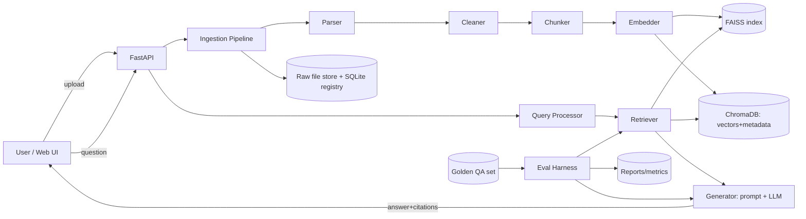

# Architecture: RAG Document Q&A Application

> **AI AGENT RULE (memory):** Read `memory.md` before changing architecture; log every structural change/ADR there and update this file's ADR table. Create `memory.md` if missing.

## 1. System Overview


## 2. Design Principles
1. **Everything configurable, nothing hardcoded** – one `config.yaml` (Pydantic-validated) drives chunking, embedder, index, k, prompts.
2. **Pluggable interfaces** – `Parser`, `Chunker`, `Embedder`, `VectorIndex`, `Retriever`, `Reranker`, `LLM` are abstract classes; Tier 2+ features are drop-in implementations.
3. **Eval-first** – no retrieval change merges without a benchmark run.
4. **Rebuildable** – raw files + config = deterministic index.

## 3. Components
| Component | Responsibility | MVP tech |
|---|---|---|
| Parser | Text + page numbers from PDF/DOCX/MD/TXT | PyMuPDF, python-docx, markdown-it |
| Cleaner | De-hyphenate, strip repeated headers/footers, collapse whitespace, normalize unicode | custom regex |
| Chunker | Recursive/sentence-aware token chunking; configurable size/overlap | tiktoken + LangChain splitters |
| Embedder | Dense vectors, batch, L2-normalized (so IP = cosine) | bge-large-en / text-embedding-3 |
| Vector index | FAISS (`IndexFlatIP` → `IndexHNSWFlat`/IVF at scale) for search; ChromaDB for persistence, metadata filters, source of truth | FAISS, ChromaDB |
| Retriever | k-NN, metadata filter, score threshold | custom |
| Generator | Builds grounded prompt, calls LLM, parses citations | LiteLLM/Instructor |
| Eval harness | Retrieval + answer metrics, experiment grid, reports | custom + Ragas |
| API | REST + SSE streaming | FastAPI |
| UI | Chat, library, eval dashboard | React (see `design.md`) |
| Jobs (Tier 3+) | Async ingestion | Celery + Redis |

**FAISS vs Chroma roles:** Chroma = durable store of chunks, embeddings and metadata. FAISS = fast ANN index rebuilt/loaded from Chroma at startup (or persisted via `faiss.write_index`). Chunk IDs are the join key.

## 4. Data Model
```
Document: doc_id(sha256), filename, mime, pages, checksum, uploaded_at, status, owner/acl(tags)
Chunk:    chunk_id, doc_id, idx, text, token_count, page_start, page_end, char_start, char_end,
          section_title, parent_id(nullable), embedding_model, config_hash
GoldenItem: id, question, reference_answer, doc_id, chunk_ids[], page, type, split(train|holdout), version
EvalRun:  run_id, config_hash, dataset_version, metrics{hit@k,mrr,faith,correct}, latency, cost, timestamp, git_sha
```
Store: SQLite (registry, eval runs) + Chroma (chunks/vectors) + filesystem (`data/raw`, `data/index`).

## 5. Pipelines
**Ingestion:** upload → checksum (skip if exists) → parse → clean → chunk → (enrich) → embed in batches → upsert to Chroma → add to FAISS → register doc `ready`.
**Query:** question → (rewrite/condense, Tier 2/4) → embed → FAISS top-k (→ hybrid/rerank Tier 2) → fetch chunk text/metadata → assemble prompt (token budget) → LLM → answer + citations → log trace.
**Prompt contract:** system prompt requires: use only provided context; cite `[doc, p.X]`; say "I don't have enough information in the documents" if unsupported; no outside knowledge. Context chunks delimited and numbered; retrieved text treated as untrusted data (prompt-injection defence).

## 6. Evaluation Architecture
- **Retrieval:** Hit Rate@{1,3,5,10}, MRR over golden set; relevance = ground-truth chunk/doc ID match (page-window tolerance configurable).
- **Answer:** embedding similarity vs reference + LLM-judge rubric (faithfulness, correctness, completeness, 1–5, JSON output); Ragas metrics in CI.
- **Experiment runner:** grid over `chunk_size × overlap × embedder × index × k`; outputs CSV + markdown table; best config promoted via `config.yaml`.
- Holdout split never used for tuning.

## 7. API (v1)
| Method | Path | Purpose |
|---|---|---|
| POST | `/documents` | upload + ingest |
| GET/DELETE | `/documents`, `/documents/{id}` | list / remove (+ delete vectors) |
| POST | `/query` | `{question, k, filters, conv_id?}` → answer, citations, contexts, timings (SSE stream option) |
| POST | `/retrieve` | retrieval only (debug) |
| GET/POST | `/golden` | manage test set |
| POST | `/eval/run` | start benchmark; GET `/eval/runs[/{id}]` |
| GET | `/health` | liveness |

## 8. Repository Layout
```
rag-qa/
├─ app/{api,core,ingestion,indexing,retrieval,generation,eval,models,utils}/
├─ configs/config.yaml
├─ data/{raw,index,golden}/
├─ frontend/
├─ tests/{unit,integration,eval}/
├─ scripts/        # ingest.py, run_eval.py, build_golden.py
├─ docs/ADR/
├─ PRD.md Architecture.md Rules.md phases.md design.md memory.md
└─ pyproject.toml  .env.example
```

## 9. Enhancement Insertion Points (Tier 2+)
| Feature | Where it plugs in |
|---|---|
| Hybrid BM25 + RRF | `Retriever` wraps dense + BM25; fuse with RRF (k=60) |
| Cross-encoder rerank | after retrieve top-50 → `Reranker` → top 3–5 |
| Small-to-big | index child chunks; `parent_id` lookup at fetch |
| Contextual enrichment | Chunker post-step prepends title/section/summary before embed |
| Query transforms | `QueryProcessor` strategies: HyDE, multi-query, step-back |
| Incremental index | checksum registry + delta upsert/delete by `doc_id` |
| Multi-turn | condense (history + question) → standalone query |
| CRAG/multi-hop | orchestration layer around `Retriever` with confidence gate |
| RBAC | mandatory metadata filter injected server-side from auth context |
| Semantic cache | pre-retrieval vector lookup, similarity ≥ threshold |

## 10. Cross-Cutting
- **Security:** env secrets, upload validation (type, size, magic bytes), path sanitization, no doc text in INFO logs, prompt-injection-safe prompts, CORS allowlist.
- **Observability:** structured JSON logs, per-stage timings, trace IDs; Langfuse/Phoenix later.
- **Scaling path:** FAISS flat → HNSW/IVF-PQ; Chroma → Qdrant/Pinecone behind `VectorIndex` interface.
- **Deployment:** Docker Compose (api, frontend, redis, optional worker); `.env` driven.

## 11. Production Stack
| Layer | Choice |
|---|---|
| Parsing | PyMuPDF, Unstructured, LangChain/LlamaIndex readers |
| Embeddings/Rerank | bge-large-en, text-embedding-3, Cohere Rerank / BGE-Reranker |
| Vector | FAISS, ChromaDB → Qdrant/Pinecone |
| Orchestration | LangChain/LlamaIndex or LiteLLM + Instructor |
| Eval | Ragas, TruLens, DeepEval |
| Backend | FastAPI, Celery, Redis |
| Observability | Langfuse, Phoenix, OpenTelemetry |

## 12. ADR Log
| ID | Decision | Status | Date |
|---|---|---|---|
| ADR-001 | FAISS for search + Chroma for persistence; chunk_id join | Accepted | — |
| ADR-002 | Pluggable interfaces for all pipeline stages | Accepted | — |
| ADR-003 | Normalize embeddings → inner product == cosine | Accepted | — |
| ADR-004 | Hold-out split for golden set | Accepted | — |
(Add new rows; mirror in `memory.md` decisions log.)
